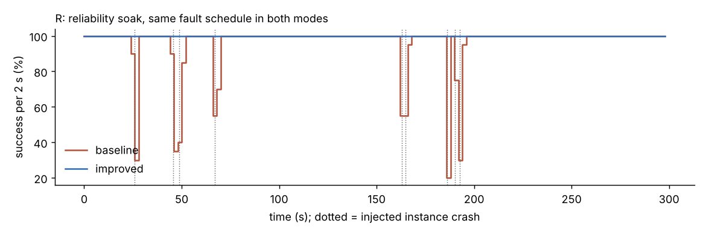
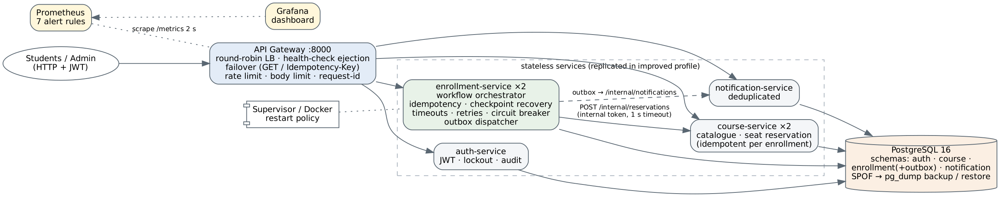
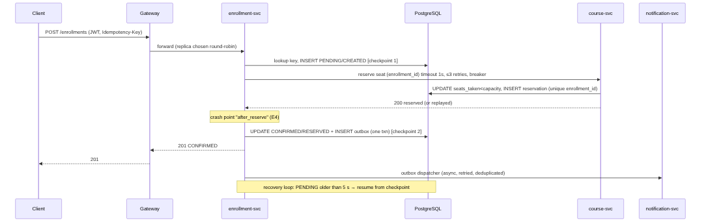
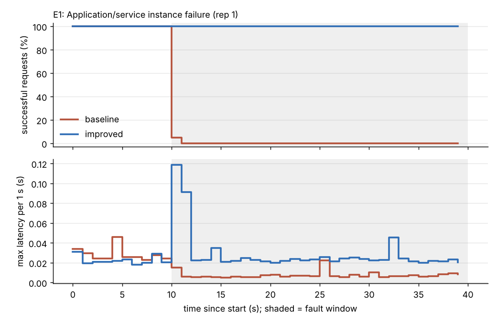
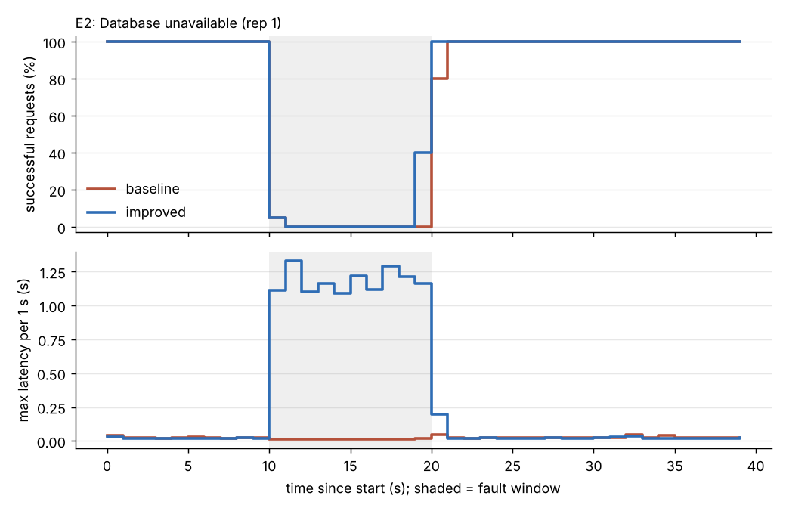
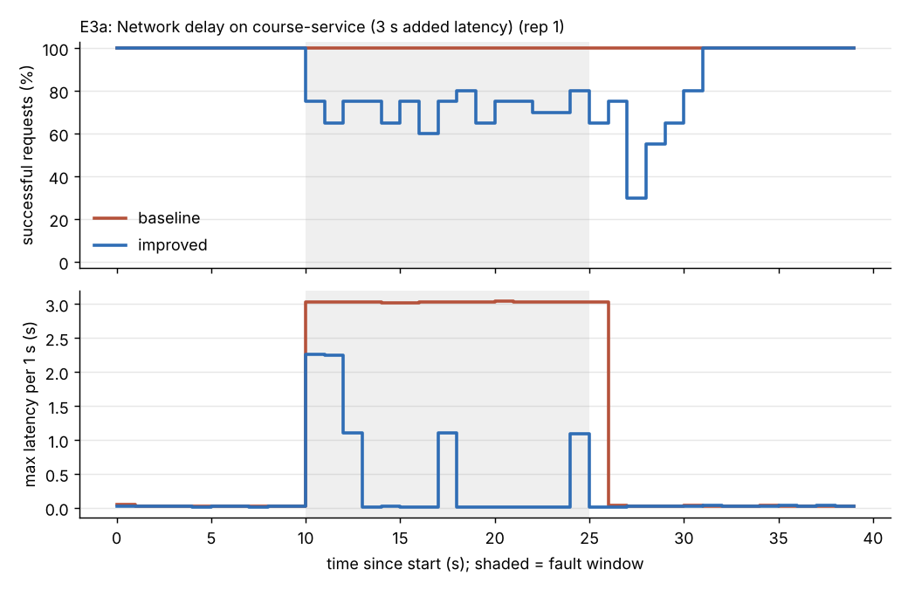
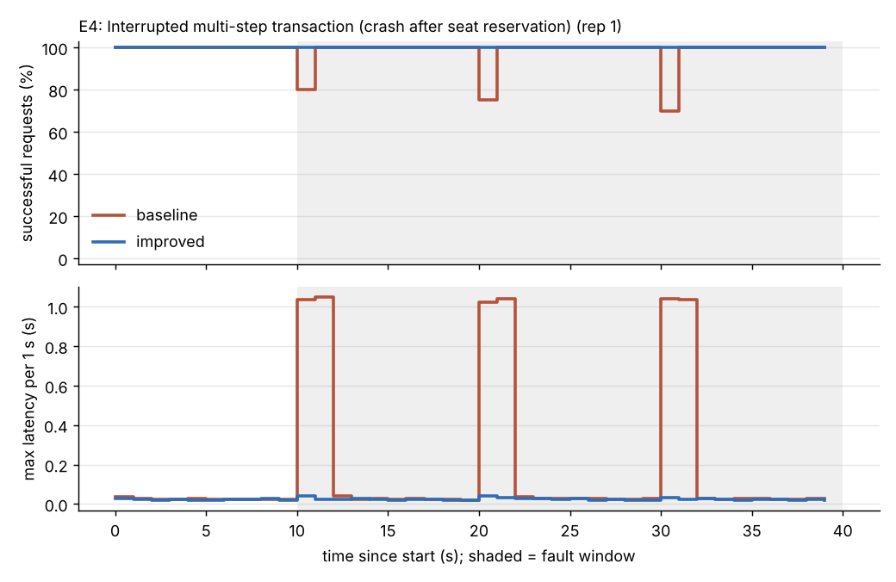
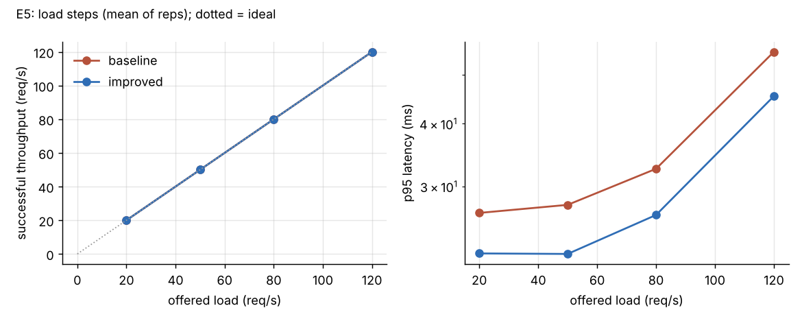
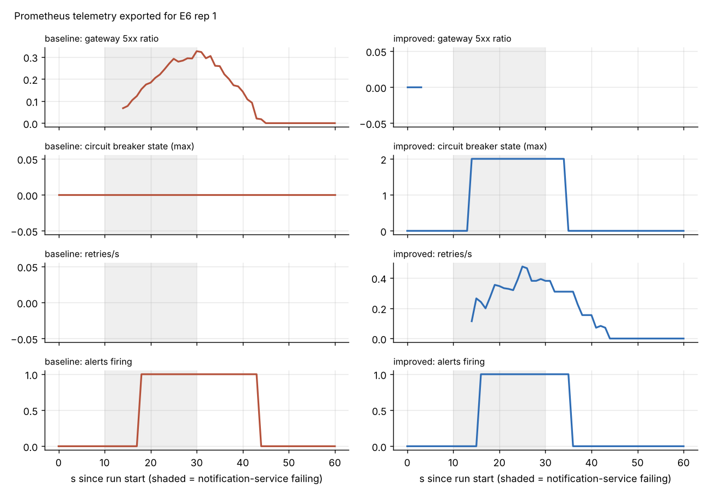

# UniDep: Design and Evaluation of a Dependable University Enrollment System

**Course:** Fault Tolerance and Dependable Computing, Final Project (Integrated Dependability Engineering Capstone)
**Team:** Kalybekov Sultan (individual project). **Repository:** https://github.com/borzki/unidep. **Contributions:** see Section 13.
**Date:** November 2026

## Abstract

This project covers the design, implementation and experimental evaluation of UniDep, a microservice-based university enrollment system. It has four services, an API gateway and PostgreSQL. The critical workflow is enrolling a student in a course. It spans three services and two persistent state changes: the seat reservation and the enrollment confirmation. We set six measurable dependability objectives, built a fault model and a threat model, and implemented the following mechanisms:

- three infrastructure-level mechanisms: service replication with health-checked load balancing and failover, an automatic restart policy, and database backup/restore;
- eight software-level mechanisms: timeouts, bounded retries with exponential backoff, a circuit breaker, idempotency keys with duplicate detection, checkpoint recovery, compensation, a transactional outbox for graceful degradation, and health/readiness checks.

Each mechanism can be switched off. That allowed the same code to be measured as a *baseline* profile and an *improved* profile across eight fault-injection experiments plus a reliability soak, three repetitions each where feasible. All numbers in this report come from those runs. The raw request logs, service logs and alert data are included in the repository.

**Keywords:** fault tolerance, microservices, circuit breaker, idempotency, fault injection, availability, MTTR, observability

## 1. Introduction and system context

At the start of each semester, students enroll in courses that have a fixed number of seats. Enrollment demand is bursty, and failures are costly:

- a lost enrollment means a student misses a course;
- a duplicate enrollment or a leaked seat means another student is wrongly turned away;
- an outage during the enrollment window produces a flood of support tickets.

The system must therefore stay available when individual components fail, and it must never corrupt seat accounting.

**Users.** Students browse courses, enroll, view their enrollments, cancel, and receive notifications. Administrators create courses and can trigger recovery.

**Data.** User accounts (salted PBKDF2 password hashes), the course catalogue with seat counters, seat reservations, enrollments, a notification outbox, notifications, and a security audit log. All data in this project is synthetic.

**Critical workflow (enrollment).**
1. Create the enrollment record (PENDING).
2. Reserve a seat in the course service.
3. Confirm the enrollment and enqueue a notification.
4. Deliver the notification.

Steps 1-3 change state in two services, so a failure between them can leave the system inconsistent.

**Assumptions.**
- A1: a single site (one host or cluster) and a single PostgreSQL primary.
- A2: crash-stop failures of processes, and omission/timing failures of network calls. Byzantine faults are out of scope.
- A3: clients behave reasonably. They may retry, and when they do they reuse the same Idempotency-Key.
- A4: the load is at most about 50 req/s per deployment in this lab setting.
- A5: the test host is shared by all components (2 vCPU, 7 GB RAM), so resource contention is a confounding factor (Section 11).

## 2. Requirements and dependability objectives

**Critical functions.**
- F1: enroll in a course.
- F2: browse the catalogue.
- F3: view and cancel your own enrollments.
- F4: authenticate.
- F5: deliver notifications. This is non-critical and may be deferred.

| ID | Objective (SLO) | Measure | Target |
|---|---|---|---|
| SLO-1 | Workflow availability under a single-instance failure | successful (2xx) / total requests in the experiment window | >= 99.5% |
| SLO-2 | Bounded latency | p99 of all requests, including during dependency slowness | < 5 s (p95 < 1 s when no fault) |
| SLO-3 | Recovery | time from fault (or end of fault) until 3 consecutive 1-s bins reach >= 95% success | <= 5 s |
| SLO-4 | Data integrity | duplicate active enrollments, duplicate or leaked seats, seat-counter mismatch, acknowledged-but-not-confirmed enrollments, stuck PENDING records | 0 after a 15 s recovery window |
| SLO-5 | Incident detection | fault start until the first Prometheus alert fires | <= 10 s |
| SLO-6 | Security | misuse cases denied with the expected code and recorded in the audit/security log | 100% |

**Terminology** (Avizienis et al.):
- A *fault* is the adjudged cause, for example a killed process, a stopped database or injected latency.
- An *error* is the resulting incorrect internal state, for example a PENDING enrollment whose seat is reserved but not confirmed, or an open connection to a dead replica.
- A *failure* is a deviation of the delivered service that users can observe, for example a 5xx response, a response slower than the SLO, or a wrong seat count.

The mechanisms in this project aim to stop errors from turning into failures (masking, failover) or to remove errors afterwards (recovery).

## 3. Fault model, threat model and failure analysis

### 3.1 Fault model

| Class | Fault | Persistence | Injected by |
|---|---|---|---|
| Crash | application process killed (SIGKILL) | permanent until restarted | `supervisor.py kill` |
| Crash, in a critical section | process exits between "seat reserved" and "confirmed" | transient | chaos `crash_point=after_reserve` |
| Dependency outage | PostgreSQL stopped (`-m immediate`) | 10 s | `pg_ctl` |
| Timing | +3 s latency on course-service calls | 15 s | chaos `latency_ms` |
| Omission/value | 30% of course-service calls return 503 | 20 s | chaos `error_rate` |
| Dependency failure, non-critical | notification service returns 503 for every call | 20 s | chaos `error_rate=1` |
| Overload | offered load 20 → 120 req/s | 80 s | load generator |
| Operator error | enrollment/reservation data deleted | permanent without a backup | SQL in E8 |
| Malicious | forged, expired or `alg=none` tokens, IDOR, injection payloads, brute force, flooding | n/a | E7 scripts |

### 3.2 Failure scenarios and impact

| # | Scenario | Error state | User-visible failure without mitigation | Severity | Mitigation | Experiment |
|---|---|---|---|---|---|---|
| FS1 | enrollment or course instance crashes | dead endpoint, broken connections | 502 responses on every request routed to it | High | replicas, health-check ejection, gateway failover, restart policy | E1, R |
| FS2 | database unavailable | broken pool connections | 5xx responses; possible partial writes | Critical | fail-fast readiness, DB retry, atomic transactions, recovery loop | E2 |
| FS3 | slow course service | threads/connections held, queues build up | very slow enrollments, cascading resource exhaustion | High | 1 s timeout, bounded retries, circuit breaker, PENDING + recovery | E3a |
| FS4 | intermittent errors from course service | failed reservation calls | sporadic enrollment failures | Medium | retries with backoff and jitter on idempotent calls | E3b |
| FS5 | crash after seat reserved, before confirm | orphan reservation and PENDING record; client retries | leaked seat, duplicate enrollment, lost acknowledgement | Critical (integrity) | Idempotency-Key, unique constraints, idempotent reservation, checkpoint recovery | E4 |
| FS6 | notification service down | undeliverable messages | enrollment fails although the seat is taken (baseline) | Medium | transactional outbox, asynchronous dispatch, circuit breaker | E6 |
| FS7 | traffic spike | CPU saturation | high latency, timeouts | High | capacity limits, rate limiting, timeouts (partial; see results) | E5 |
| FS8 | accidental data deletion | lost rows | enrollments disappear | Critical | pg_dump backup + restore | E8 |
| FS9 | unauthorised access | n/a | data disclosure or modification | Critical | JWT, RBAC, object-level checks, internal token, validation, audit | E7 |

### 3.3 Single points of failure

| Component | Single point of failure? | Treatment in this project |
|---|---|---|
| PostgreSQL primary | **Yes** | Not replicated, because of scope. Mitigated by fail-fast behaviour, automatic reconnection and backups (RPO = backup interval). Streaming replication with automatic promotion is future work. |
| API gateway | **Yes** (one instance) | Stateless, so it can be replicated behind a cloud load balancer or a Kubernetes Service. Here it is restarted automatically. |
| auth-service, notification-service | single instance | auth is only needed at login, because tokens are verified locally in every service. Notification failures are absorbed by the outbox. |
| course-service, enrollment-service | no (2 replicas in improved) | failover through gateway health checks and client-side failover |
| Host | **Yes** (lab) | Out of scope. A multi-node cluster would remove it. |

### 3.4 Threat model (STRIDE, assets: enrollments, seat counters, credentials, audit log)

| Threat | Example | Control | Tested |
|---|---|---|---|
| Spoofing | forged or `alg=none` JWT; brute-force passwords | HS256 signature check with a pinned algorithm; PBKDF2 hashes (100k iterations); lockout after 5 failures in 60 s | S2, S3, S4, S11, S15 |
| Tampering | SQL injection; editing someone else's enrollment | parameterised SQL; strict pydantic validation; object-level ownership checks | S7, S10, S11 |
| Repudiation | denying an action | JSON logs with request id, auth audit_log table, security_events metric | evidence in E7 |
| Information disclosure | reading another student's enrollment (IDOR); internal APIs | ownership check that returns 404; internal endpoints need a service token and are blocked at the gateway | S6, S8, S9 |
| Denial of service | request floods; oversized bodies | per-user token-bucket rate limit; 16 KB body limit; timeouts | S12, S16, E5 |
| Elevation of privilege | student calls an admin operation | RBAC on role claims | S5 |

## 4. Reliability engineering

**Definitions and formulas.** Over an observation window T, a *service failure episode* is a maximal run of consecutive 1-second bins in which fewer than 95% of requests succeeded. If n is the number of episodes and D is the total downtime:

- MTTR = D / n
- MTTF = (T − D) / n, the mean up-time between episodes
- MTBF = T / n = MTTF + MTTR
- availability A = (T − D) / T = MTTF / (MTTF + MTTR)
- observed failure rate λ = n / T, given in failures per hour

The *request success ratio* (successful/total requests) is reported alongside, as a request-based availability measure. At the component level, λ_c = injected crashes / T, and the component MTTR is the time from SIGKILL until that instance's readiness probe succeeds again.

Units: seconds, failures per hour. Bin width: 1 s. Threshold: 95%.

**Data.** The soak experiment R ran for T = 300 s at 10 req/s. Nine instance crashes were injected at exponentially distributed times (mean interval 40 s, seed 7): 7 on course and 2 on enrollment, always instance 0, with the same schedule in both profiles. The restart policy was **on in both profiles**, so the baseline also has finite repair times. All values in Table 4.1 are **measured**.

**Table 4.1: Measured reliability metrics (soak R)**

| Quantity | Formula | Baseline | Improved |
|---|---|---|---|
| Requests (failed) | n/a | 3001 (116) | 3001 (0) |
| Component failure rate λ_c | 9 / 300 s | 108 h⁻¹ | 108 h⁻¹ |
| Component MTTR (kill → ready) | mean of 9 | 1.68 ± 0.06 s | 1.68 ± 0.08 s |
| Service failure episodes n | bins < 95% | 6 | 0 |
| Episode durations | n/a | 3, 6, 2, 4, 2, 5 s | none |
| Downtime D | sum | 22 s | 0 s |
| Service MTTR | D / n | 22 / 6 = **3.67 s** | n/a (no failures) |
| Service MTTF | (T − D) / n | 278 / 6 = **46.3 s** | > 300 s (no failure observed) |
| Service MTBF | T / n | 300 / 6 = **50.0 s** | > 300 s |
| Observed failure rate λ | n / T | 6 / 300 s = 0.02 s⁻¹ = **72 h⁻¹** | 0 h⁻¹ (95% upper bound 3/T = 36 h⁻¹) |
| Availability (time-based) | (T − D) / T | 278 / 300 = **0.9267** | **1.0000** |
| Availability (MTTF/(MTTF+MTTR)) | n/a | 46.3 / 50.0 = 0.9267 | 1.0000 |
| Request success ratio | 1 − failed/total | 1 − 116/3001 = **0.9613** | **1.0000** |



**Interpretation.**

*Baseline.* Six of the nine crashes caused a user-visible episode. The other three were too short to bring any 1-s bin below 95%.

The service MTTR (3.67 s) is more than twice the component MTTR (1.68 s). Two things account for the gap:
- requests already in flight to the crashed instance fail as well;
- the outage is measured in whole 1-s bins.

*Improved.* No crash became a service failure, so service MTTF cannot be measured directly. By the "rule of three", zero failures in 300 s means the true failure rate is below 36 h⁻¹ with 95% confidence (MTTF > 100 s). A longer soak would be needed to estimate it more precisely.

**Theoretical cross-check (estimate, not measured).** We treat each instance as an independent alternating-renewal component:
- course instance 0: MTTF_c = 300/7 = 42.9 s, MTTR_c = 1.68 s, so A_c = 42.9/44.6 = 0.962;
- enrollment: MTTF = 300/2 = 150 s, so A = 0.989.

The baseline is a series system: A ≈ 0.962 × 0.989 = **0.951**. The measured value (0.927) is lower because the service-level repair time exceeds the component repair time, as explained above.

For the improved profile, two replicas in parallel with independent, identical failure processes give A ≈ 1 − (1 − 0.962)² = **0.9986** per tier, an illustrative estimate. The measured value is 1.0 because in this experiment only instance 0 was ever killed, and failover hid even its downtime.
## 5. System architecture and resilience design



**Service boundaries.**
- *gateway*: edge routing and traffic resilience.
- *auth*: identity.
- *course*: catalogue and seat inventory. It is the only writer of seat counters.
- *enrollment*: orchestrator of the critical workflow, which owns the enrollment state machine.
- *notification*: user messages.

Every service owns one PostgreSQL schema and touches no other. Each service is stateless apart from the database, which is what makes horizontal replication and restarts safe. The only exceptions are the login-failure counters in auth (a documented limitation) and circuit-breaker state, which is per process by design.

**Data flows.** Clients reach the system only through the gateway. Internal calls (enrollment → course and enrollment → notification) use per-dependency replica lists, client-side round-robin, and a shared internal token. Internal routes are rejected at the gateway.



**Enrollment state machine.** PENDING/CREATED → (seat reserved) → CONFIRMED/RESERVED. A request can also end in FAILED/REJECTED (course full) or CANCELLED/RELEASED (compensation).

Both checkpoints are durable rows. The seat reservation is idempotent on `enrollment_id`, with a unique index. That means any actor can safely re-drive a PENDING enrollment: the original request, a client retry with the same key, the gateway failing over to another replica, or the background recovery loop. The workflow always rolls forward and never double-books.

The CONFIRMED update and the outbox insert happen in one transaction. A confirmed enrollment therefore always has a pending notification, and notification delivery is off the critical path.

**Deployment and runtime behaviour.**

| Aspect | Improved | Baseline |
|---|---|---|
| Replicas | course ×2, enrollment ×2, others ×1 | all ×1 |
| Restart | process restarted 1 s after exit (`restart: unless-stopped` in compose) | none |
| Health | `/health/live` (process) and `/health/ready` (DB ping ≤ 0.5 s). The gateway probes readiness every 1 s and ejects a replica after 2 failures. Compose healthchecks use the same endpoint. | gateway does not probe |
| Dependency failure | fail fast: 503 + `Retry-After`; enrollment left PENDING and finished by recovery | errors propagate; synchronous notification failure returns 500 |
| Resources | container limit 0.5 CPU / 256 MB per service (compose). Lab host: 2 vCPU shared by 7 processes, PostgreSQL, Prometheus and the load generator. | same |

**Stack justification.**
- FastAPI/uvicorn gives async I/O, which suits the many concurrent outbound calls and is easy to instrument.
- PostgreSQL provides transactional integrity, partial unique indexes and `FOR UPDATE SKIP LOCKED`, which lets the recovery loop run on several replicas at once.
- Prometheus provides alert rules as code and a query API, so detection times can be measured automatically.
- Docker Compose is the deployment format. A small process supervisor reproduces the replica and restart semantics for the experiments, because the lab environment could not pull container images (Section 11).

## 6. Fault-tolerance implementation

### 6.1 Infrastructure level (three mechanisms)

| Mechanism | Implementation | Evidence |
|---|---|---|
| I1 Replication + health-checked load balancing + failover | `services/gateway/app.py` (`Pool`, `_health_loop`, `proxy`): round-robin, ejection after 2 failed probes, retry on another replica for GET requests or requests carrying an Idempotency-Key. Client-side failover in `common/resilience.py::ResilientClient` | E1, R |
| I2 Self-healing restart policy | `deploy/local/supervisor.py` (restart 1 s after exit); `restart: unless-stopped` plus healthchecks in `docker-compose.yml` | E1, E4, R (component MTTR) |
| I3 Backup and restore | `pg_dump -Fc` and `pg_restore --clean --single-transaction` (`experiments/backup_restore.py`) | E8 (measured RTO/RPO) |

### 6.2 Software level (eight mechanisms)

| Mechanism | Where | Behaviour | Tests |
|---|---|---|---|
| S1 Timeouts | `ResilientClient(timeout=CALL_TIMEOUT_S)`, gateway client timeout, DB `command_timeout` | 1 s per call in improved (30 s in baseline) | `test_timeout_is_enforced`, E3a |
| S2 Bounded retries + exp. backoff + full jitter | `resilience.py::backoff_delay`, `ResilientClient.request` | at most 3 retries, delay U(0, min(1 s, 0.1·2^k)); only idempotent calls; 4xx is never retried | `test_retries_are_bounded`, `test_non_idempotent_calls_are_not_retried`, E3b |
| S3 Circuit breaker | `resilience.py::CircuitBreaker` | opens after 5 consecutive failures; half-open after 5 s with a single trial call | 4 unit tests, E3a, E6 |
| S4 Idempotency + duplicate detection | `enrollment/app.py::enroll` (key scoped per user, 422 if a key is reused with a different body), unique indexes in `db/reset.py`, idempotent `/internal/reservations` and notifications | a replay returns the original result with `Idempotent-Replay: true` | AC2, AC3, E4, S13 |
| S5 Checkpoint/recovery | `recover_once`, `_recovery_loop` (every 2 s, PENDING records older than 5 s, `SKIP LOCKED`) | rolls PENDING enrollments forward | E4, E3a, E2 |
| S6 Compensation (rollback) | `POST /enrollments/{id}/cancel` → `DELETE /internal/reservations/{id}` (idempotent) | releases the seat; repeated cancels are harmless | E8 part B |
| S7 Graceful degradation (transactional outbox) | `outbox` table, `_outbox_loop`, `dispatch_outbox_once` | enrollment succeeds while notifications are down; delivery resumes afterwards | E6 |
| S8 Health/readiness checks + fail-fast | `common/app_base.py` | readiness pings the DB with a 0.5 s budget and exposes breaker states; the gateway uses it to eject replicas | E1, E2 |

In addition, transient DB connection errors are retried (`common/db.py::Database.run`, at most 4 attempts with backoff), and every multi-row change runs in a single transaction.

The unit tests (`tests/test_mechanisms.py`, 14 tests) and acceptance tests (`tests/test_acceptance.py`, AC1-AC9) all pass. See Appendix A.

## 7. Monitoring, observability and security implementation

**Structured logs.** Every service writes one JSON object per line: `ts`, `level`, `service`, `instance`, `request_id`, `msg`, plus extra fields. The gateway accepts or creates `X-Request-ID` and propagates it on every internal call, so one request can be followed across services with `grep <id> results/raw/*/logs/*.log`. Security events go to a dedicated `audit` logger and to the `auth.audit_log` table.

**Metrics** (Prometheus, scraped every 2 s):
- `http_requests_total{service,route,method,status}` and the histogram `http_request_duration_seconds`
- `downstream_calls_total{target,outcome}`, `downstream_retries_total`
- `circuit_breaker_state`, `circuit_breaker_open_total`
- `gateway_failover_total`, `gateway_upstream_healthy`
- `enrollments_total{outcome}`, `recovery_actions_total{action}`
- `security_events_total{event}`, `gateway_rate_limited_total`
- default process metrics

**Alert rules** (`deploy/prometheus/alerts.yml`, evaluated every 2 s):

| Alert | Expression (summary) | for |
|---|---|---|
| ServiceInstanceDown | `up == 0` | 4 s |
| HighGatewayErrorRate | gateway 5xx ratio over 15 s > 5% | 4 s |
| CircuitBreakerOpen | `circuit_breaker_state == 2` | 0 s |
| HighEnrollmentLatencyP95 | p95 of `proxy:enrollment` > 1 s | 4 s |
| SecurityDenialSpike | more than 10 security events in 30 s | 0 s |
| StuckPendingEnrollments | any `dependency_unavailable` outcome in 30 s | 0 s |
| InstanceRestarted | `changes(process_start_time_seconds[20s]) > 0` | 0 s |

The Grafana dashboard (`deploy/grafana/dashboards/unidep.json`) has ten panels covering these signals.

**Security controls.**
1. JWT (HS256) authentication with a pinned algorithm and required `exp`/`sub` claims.
2. Role-based access control.
3. Object-level authorisation. A request for another user's object returns 404, so the object's existence is not revealed.
4. Internal endpoints protected by a service token and not routed by the gateway.
5. Strict input validation (pydantic patterns and lengths) and parameterised SQL.
6. A 16 KB request body limit.
7. Login lockout (5 failures per 60 s per username).
8. Per-user token-bucket rate limiting at the gateway.
9. PBKDF2-SHA256 password hashing.
10. An audit trail.

All secrets are injected through the environment. The repository holds only placeholders.

**Demo console.** The gateway also serves a small web console at `/`, added after the experiments for demonstrations. It lets a student sign in, enroll, resend a request with the same Idempotency-Key, and cancel. It shows the readiness of every replica and the breaker states of both enrollment replicas, polled every second, and a request log with the replica that served each request. Its fault-injection buttons (Crash now, Crash mid-transaction, Slow +3 s, Fail 30%/100%, Heal) relay to the token-protected `/chaos` endpoints. The console uses only the public API plus two gateway endpoints (`/ui/status`, `/ui/chaos`), and its polling is excluded from the request metrics so that it does not dilute the error-rate alerts.
## 8. Verification, validation and experimental methodology

**Verification.**
- 14 unit tests check each mechanism in isolation: breaker transitions, backoff bounds, retry bounds, the no-retry rule for non-idempotent calls, timeouts, breaker fail-fast behaviour, password hashing, and token signature/expiry.
- 9 acceptance tests (AC1-AC9) check the end-to-end behaviour of a running stack against the requirements.

**Baseline vs improved.** One codebase, two profiles (README, "Profiles" table). The baseline turns off every software mechanism, runs a single replica of each service, has no restart policy, no gateway health checks or failover, a 30 s call timeout, and no backups. The improved profile enables everything. The security controls are identical in both profiles except rate limiting. The DB integrity constraints (unique idempotency key, one active enrollment per student/course, one reservation per enrollment) count as part of the improved design and are created only in that profile.

**Pre-registration.** Every run stores `plan.json` (hypothesis, workload, fault, window, success criterion) next to its data. Plans are defined in code (`experiments/run.py::plan`) before the run starts.

**Environment.**
- One Linux VM: 2 vCPU, 7 GB RAM, Python 3.13, PostgreSQL 16.15, Prometheus 2.54.1.
- Services run as uvicorn processes under `deploy/local/supervisor.py`. The load generator runs on the same host.
- The database is reset and seeded before every run: 500 students, 10 courses × 1000 seats.

**Workload.**
- An open-loop generator: requests are sent on a fixed schedule whether or not earlier ones have completed, so a slow system cannot reduce the offered load.
- Default rate: 20 req/s, 70% `GET /courses` and 30% `POST /enrollments`.
- Each enrollment uses a fresh student-course pair and a fresh Idempotency-Key. Load lasts 40 s, with the fault starting at t = 10 s.
- The client does not retry, except in E4, where it retries once after 1 s with the same key.
- Client timeout: 35 s.

**Measurements per run.**
- Every request: send time, status, latency, attempts, serving instance, request id.
- Fault times (fixed by the plan; actual times in `supervisor_events.jsonl`).
- Detection time: the first Prometheus alert that starts firing after the fault, queried from `ALERTS`.
- Recovery time: the first of 3 consecutive 1-s bins with ≥ 95% success after the fault starts. A run that never reaches this is reported as *not recovered*, a right-censored value.
- Retry, breaker, failover and recovery counts, taken from the JSON logs. Prometheus `increase()` values are stored too, but they extrapolate and can miss the first increments after a restart.
- Data-integrity checks, taken twice: immediately after the load stops, and again after a 15 s quiet period that lets recovery and the outbox finish.

**Repetitions.** E1-E4 and E6 were run 3 times per profile, E5 twice per profile, E7 once per profile (the cases are deterministic), E8 part A 3 times per profile with part B once, and the soak R once per profile with an identical, seeded fault schedule. Values are reported as mean ± sample standard deviation over repetitions.

**Data-integrity checks.** These are SQL checks (`experiments/lib.py::integrity`):
- duplicate active enrollments per (student, course);
- duplicate reservations per enrollment;
- seat-counter mismatches (`seats_taken` compared with the count of reservations);
- leaked seats (a reservation with no PENDING/CONFIRMED enrollment);
- CONFIRMED enrollments without a seat;
- enrollments acknowledged to the client (2xx) but not CONFIRMED in the database;
- duplicate notifications;
- PENDING records left over.

The "violations" column is the sum of these counts. Confirmed enrollments that have no notification are reported separately: delivery is allowed to lag, but in the improved profile it must reach 0.
## 9. Results

Every value below was measured. Values are the mean ± standard deviation over repetitions (n = 3 unless stated), and the full table is in `results/summary.csv`. "Success" means HTTP 2xx, and requests are counted by send time. "Eventually confirmed" is the share of enrollment requests whose enrollment was CONFIRMED in the database after the 15 s quiet period. "Violations" is the sum of the integrity checks in Section 8.

### 9.1 Consolidated results (baseline vs improved)

| Exp | Profile | Success, all (%) | Success, enroll (%) | Eventually confirmed (%) | Success during fault (%) | p95 / p99 (ms) | Recovery (s) | Detection (s) [first alert] | Retries / CB opens / failovers / recovered | Violations after 15 s |
|---|---|---|---|---|---|---|---|---|---|---|
| E1 instance crash | baseline | 25.09 ± 0.00 | 22.79 ± 1.56 | 22.79 | 0.17 | 23 / 27 | not recovered (3/3) | 7.0 ± 1.0 [HighGatewayErrorRate] | 0 / 0 / 0 / 0 | 0 |
| | improved | **99.96 ± 0.07** | 99.86 ± 0.24 | 100.0 | 99.94 | 24 / 49 | **0.0** | 3.7 ± 0.6 [InstanceRestarted] | 9 / 0 / 3.7 / 0.3 | 0 |
| E2 DB down 10 s | baseline | 74.74 ± 0.07 | 73.78 ± 2.15 | 73.78 | 0.50 | 23 / 27 | 11.0 ± 0.0 | 8.0 [HighGatewayErrorRate] | 0 / 0 / 0 / 0 | 0 |
| | improved | 76.36 ± 0.19 | 75.56 ± 1.46 | 75.56 | 5.33 | **948 / 1170** | 10.0 ± 0.0 | 8.0 [HighGatewayErrorRate] | 0 / 0 / 9.7 / 0 | 0 |
| E3a +3 s latency | baseline | 100.0 | 100.0 | 100.0 | 100.0 | **3025 / 3030** | 0.0 | 10.0 [HighEnrollmentLatencyP95] | 0 / 0 / 0 / 0 | 0 |
| | improved | 83.81 ± 0.19 | **46.56 ± 1.19** | 100.0 | 68.67 | **22 / 1093** | 20.3 ± 0.6 | 4.0 [CircuitBreakerOpen] | 26.3 / 6 / 0 / 129.7 | 0 (37 PENDING at load end) |
| E3b 30% transient 503 | baseline | 95.59 ± 0.44 | 85.45 ± 1.26 | 85.45 | 91.17 | 25 / 29 | 9.7 ± 3.5 | 4.0 [StuckPending…] | 0 / 0 / 0 / 0 | 0 |
| | improved | **98.84 ± 1.49** | 96.17 ± 4.86 | 100.0 | 97.67 | 31 / 176 | 0.0 | 6.0, 10.0 (2/3 runs; run 2 fully masked, no alert) | 59.7 / 0.3 / 0 / 9.3 | 0 |
| E4 crash mid-transaction (×3) | baseline | 98.29 ± 0.19 | 94.36 ± 0.70 | 94.36 | 97.72 | 30 / 1031 | 1.0 | 13.3 ± 4.6 [HighGatewayErrorRate] | 0 / 0 / 0 / 0 | **3 ± 0** (orphan PENDING holding seats) |
| | improved | **100.0** | 100.0 | 100.0 | 100.0 | 22 / 27 | 0.0 | see text | 0 / 0 / 6 / 0 | **0** |
| E5 load 20→120 req/s (n = 2) | baseline | 100.0 | 100.0 | 100.0 | n/a | 42 / 72 | n/a | no alert | 0 / 0 / 0 / 0 | 0 |
| | improved | 100.0 | 100.0 | 100.0 | n/a | 34 / 61 | n/a | no alert | 0 / 0 / 0 / 0 | 0 |
| E6 notification 100% failing | baseline | 85.57 ± 0.40 | **51.68 ± 0.95** | 100.0 | 67.58 | 25 / 29 | 20.0 | 8.0 [HighGatewayErrorRate] | 0 / 0 / 0 / 0 | 0 (but 130 users told "failed" although enrolled) |
| | improved | **100.0** | 100.0 | 100.0 | 100.0 | 22 / 27 | 0.0 | 4.7 ± 1.2 [CircuitBreakerOpen] | 14 / 8 / 0 / 0 | 0 |

No alert fired before any fault was injected in any run (0 false positives in 40 runs), and no alert fired during the fault-free load test E5. The counters come from the JSON logs ("recovered" counts distinct enrollments).

### 9.2 Per-experiment analysis

**E1: instance failure** (Fig. E1).
- *Baseline.* After SIGKILL of the only enrollment and course instances, every request routed to them failed and the system never recovered within the window: 25.1% overall success, the critical workflow unavailable for the remaining 30 s. That matches the hypothesis.
- *Improved.* Availability was 99.96%, with 1 failed request out of 2,403 across the three runs, at the moment of the kill. That request was a 503 *PENDING* response, and the recovery loop completed it, so 100% of enrollments were eventually confirmed.
- The supervisor observed each exit within ≤ 1.1 s and respawned the instance after the 1 s restart delay. The gateway moved traffic in 3.7 ± 0.6 failovers per run.
- *Cost:* p99 latency rose from 27 to 49 ms because of the requests retried on the surviving replica.
- **SLO-1 met** in the improved profile (≥ 99.5%) and violated by the baseline.



**E2: database unavailable.**
- The database is a single point of failure, and both profiles lose about 25% of requests: everything sent during the 10 s outage.
- The improved profile is only slightly better (76.4% vs 74.7%). Its DB-retry policy rescued requests at the edges of the outage (5.3% vs 0.5% success during the fault), but it held each failing request for about 1 s, so the p95 latency of the run rose to 948 ms. That is the price of retrying against a dependency that is down. A readiness-driven short-circuit would avoid it (Section 11).
- Both profiles recovered as soon as PostgreSQL came back: the first fully healthy bins appeared 0-1 s after the restart.
- No partial writes or integrity violations occurred, because every multi-row change is a single transaction.
- The hypothesis "fail fast" was **only partially confirmed**: the system failed safely, but not fast.



**E3a: network delay** (Fig. E3a). The two profiles show a clear trade-off.
- *Baseline.* Every request succeeded, but every enrollment took about 3 s (p95 3025 ms). That violates the 1 s latency objective, and at higher load it would exhaust connections.
- *Improved.* The 1 s timeout and the circuit breaker (6 openings per run) bounded latency (p95 22 ms, p99 1.09 s), but only 46.6% of enrollments returned 2xx. The rest received a fast 503 *accepted as PENDING*, and the recovery loop confirmed every one of them after the delay was removed (100% eventually confirmed, 0 violations).
- Recovery took 20.3 s from fault start, which is 5.3 s after the delay ended. The lag is the circuit breaker's 5 s reset timeout followed by a single half-open trial.
- *Finding:* the breaker prevents a cascading failure, but it converts slow successes into deferred successes. For a workflow where users can wait 3 s, a longer timeout budget (for example 4 s) with the breaker kept for hard failures would be the better setting.



**E3b: transient errors.**
- Retries with jitter raised enrollment success from 85.5% to 96.2% (overall from 95.6% to 98.8%). The cost was about 60 retries per run and a higher p99 (176 ms vs 29 ms).
- The improved runs were not uniform: 98.3%, 99.6% and 90.6% for enrollments. In the third run five consecutive failed attempts opened the breaker, and requests failed fast for 5 s. Those enrollments were completed by recovery (100% eventually confirmed).
- *Finding:* with a 30% error rate, a threshold of 5 consecutive failures is too sensitive. A breaker based on failure rate over a sliding window would avoid this false trip. The hypothesis (≥ 97% enrollment success) was met in 2 of 3 runs.

**E4: interrupted transaction.** This is the core integrity experiment.
- The enrollment instance hard-exited three times per run, right after reserving a seat and before confirming the enrollment.
- *Baseline.* Each crash left an orphaned PENDING enrollment holding a reserved seat. The client was told the request failed, and its retry hit a restarting single instance. **3 violations per run, all 3 runs; they persist after the quiet period** because no mechanism repairs them.
- *Improved.* The gateway re-sent each interrupted request, which carried an Idempotency-Key, to the other replica (6 failovers per run). That replica found the existing PENDING record by its key, re-ran the idempotent reservation (no second seat) and confirmed it. Result: 100% success, **0 duplicate enrollments, 0 leaked seats, 0 lost acknowledgements**.
- In this experiment the recovery loop was not needed. It is exercised in E3a, where it confirmed 130 PENDING enrollments per run.
- Detection: InstanceRestarted fired, but because restarts in the first 20 s of every run also trigger it, those episodes merged with the start-up alert, so we do not report an alert-based detection time for E4. The supervisor detected each crash in under 0.2 s (exit observed on its next 0.2 s poll).



**E5: load** (Fig. E5). Both profiles served 100% of requests at every step up to 120 req/s.
- p95 latency was 34 ms (improved) and 42 ms (baseline), and throughput tracked the offered load exactly.
- The hypothesis that saturation would appear in this range was **not confirmed**: the system was not the bottleneck at 120 req/s.
- The improved profile's lower tail comes from spreading load over two replicas, which outweighs the small per-request cost of idempotency lookups.
- We also tried to search for saturation at 150-350 req/s. We aborted that run and excluded it: the single-process Python load generator, running on the same 2-vCPU host, was itself CPU-bound (82% CPU) and could not keep to its send schedule, so the measurements would have described the client, not the system (log kept in `results/e5b_aborted.log`). Finding the real saturation point needs a load generator on a separate machine (Section 11).



**E6: monitoring and alerting.**
- *Baseline.* With notifications on the critical path, 48% of enrollment requests returned 500 *although the enrollment was committed*: 130 ± 4 enrollments per run were confirmed but reported as failed, and none of them were notified. Data integrity in the database was fine, but what the client was told was wrong.
- *Improved.* The outbox kept 100% of enrollments successful. The breaker opened 8 times per run, and all queued notifications were delivered after the fault (0 confirmed enrollments without a notification).
- *Detection.* CircuitBreakerOpen fired 4.7 ± 1.2 s after fault start (improved), and HighGatewayErrorRate after 8.0 s (baseline). **SLO-5 (≤ 10 s) met in both.**
- *Diagnosis.* One failed baseline request (id `c5ce9793049f4267`) can be followed across four services with a single grep:

```
17:45:12.562 course        POST /internal/reservations   200   3.0 ms
17:45:12.566 notification  POST /internal/notifications  503   0.4 ms
17:45:12.567 enrollment    notification_failed  enrollment_id=8e8c48bf-…  UpstreamError
17:45:12.567 enrollment    POST /enrollments             500  12.5 ms
17:45:12.569 gateway       proxy:enrollment              500  15.9 ms
```

The trace shows the root cause (notification returning 503) and the consequence (seat reserved, but the client received a 500) without any further tooling.



### 9.3 Security and misuse (E7)

| ID | Case | Expected | Baseline | Improved |
|---|---|---|---|---|
| S1 | no token | 401 | 401 | 401 |
| S2 | forged admin JWT (wrong key) | 401 | 401 | 401 |
| S3 | `alg=none` token | 401 | 401 | 401 |
| S4 | expired token | 401 | 401 | 401 |
| S5 | student creates a course (admin only) | 403 | 403 | 403 |
| S6 | IDOR read of another student's enrollment | 404 | 404 | 404 |
| S7 | IDOR cancel of another student's enrollment | 404 | 404 | 404 |
| S8 | internal API through the gateway | 404 | 404 | 404 |
| S9 | internal API called directly without the service token | 403 | 403 | 403 |
| S10 | SQL-injection payload in course code | 422 | 422 | 422 |
| S11 | SQL-injection payload as username | 422 | 422 | 422 |
| S12 | 100 KB body | 413 | 413 | 413 |
| S13 | Idempotency-Key reused with a different body | 422 (improved) | 201: accepted, key ignored | 422 |
| S14 | chaos endpoint without its token | 403 | 403 | 403 |
| S15 | 7 wrong passwords, then the correct one | 401×5, 429×2, then 429 | as expected | as expected |
| S16 | 120 concurrent requests from one user | throttled (improved) | 0/120 throttled | 77/120 → 429 |

All 16 cases behaved as expected in both profiles (16/16). The two cases that differ show what the improved profile adds: request-integrity checking (S13) and flood protection (S16). **SLO-6 met.**

Audit evidence:
- `auth.audit_log` recorded 5 `login_failed`, 3 `login_locked` and 3 `login_ok` events.
- Each denial produced a `security_event` JSON line with the user, path and client, for example `{"event": "idor_denied", "user": "student0002", "enrollment_id": "e4a2a6bc-…"}`.
- Raw files are in `results/raw/E7/<profile>/`.

### 9.4 Recovery, rollback and failover verification (E8)

**Part A: backup and restore**, after a simulated operator error that deleted all enrollment, reservation and notification data at t ≈ 33 s:

| Metric | Baseline (no backup) | Improved (pg_dump at t = 15 s) |
|---|---|---|
| Confirmed enrollments before the incident | 286 / 304 / 293 | 286 / 304 / 293 |
| Records lost (RPO, records) | **286 / 304 / 293 (all)** | **138 / 158 / 153** (those created after the backup) |
| RPO (time) | ∞ | 18.0 s (backup → incident) |
| Backup duration | n/a | 0.075-0.101 s |
| Restore duration | n/a | 0.057-0.064 s |
| RTO, from incident to verified state | not recoverable | 8.1 s (includes a fixed 8 s settle-and-verify wait) |
| Integrity after recovery | consistent but empty | 0 violations (3/3) |
| Acceptance probe (20 new enrollments) | 20/20 | 19, 18, 19 created; the remaining 1, 2, 1 correctly rejected with 409 as duplicates of restored enrollments |

**Part B: compensation.** 40 students enrolled in a course. 20 then cancelled, and 5 of those cancelled a second time. The seat counter went from 40 to 20, exactly the number of cancellations, with 0 integrity violations. Repeated cancels were harmless in both profiles.

The RPO equals the backup interval, which is the expected weakness of periodic logical backups. Continuous WAL archiving or a streaming replica would reduce it to seconds (Section 11).
## 10. Were the dependability objectives met?

| Objective | Baseline | Improved | Evidence |
|---|---|---|---|
| SLO-1 availability ≥ 99.5% under a single-instance failure | **No** (25.1%) | **Yes** (99.96%) | E1, R |
| SLO-2 p99 < 5 s, p95 < 1 s without a fault | p99 met; p95 violated during slowness (3.0 s) | p99 met in all experiments (max 1.2 s); p95 met except during the DB outage (948 ms run-level, just under 1 s) | E2, E3a, E5 |
| SLO-3 recovery ≤ 5 s | **No** for crashes (not recovered); yes after the DB returned (≈1 s) | **Yes** for crashes (0 s) and the DB (≈0 s after return). **No** for slowness: 5.3 s after the fault ended, caused by the breaker reset | E1-E3 |
| SLO-4 zero integrity violations after 15 s | **No** (E4: 3 orphan seats per run; E6: 130 wrong failure responses per run) | **Yes**: 0 in every run of every experiment | all |
| SLO-5 detection ≤ 10 s | Mostly (4-10 s; E4 13.3 s violates) | Yes (3.7-10 s) for every incident with user-visible errors; fully masked incidents raised no error alert | E1-E6 |
| SLO-6 100% of misuse denied and logged | Yes, except flood (no rate limit) and key-reuse checking | **Yes** (16/16) | E7 |

## 11. Discussion, limitations and future work

**What worked.**
- Redundancy plus health-checked failover turned a total outage into an imperceptible one (E1).
- Idempotency keys combined with an idempotent downstream operation and durable checkpoints removed every integrity violation that crashes caused (E4).
- The outbox turned a failure of a non-critical dependency into a non-event for users (E6).
- Prometheus alerts fired within 3.7-13 s for every incident that caused user-visible errors, with zero false positives. Incidents the mechanisms masked completely (E3b run 2; the E4 crashes in the improved profile) raised no error alert, which is arguably correct but means masked faults show up only in the logs and the breaker/retry metrics.

**Trade-offs we measured.**
1. *Latency vs availability under slowness (E3a).* Fail-fast mechanisms turn slow successes into deferred successes. They protect the system's resources but reduce immediate success to 47%.
2. *Retry cost (E2, E3b).* Retrying a dependency that is down adds about 1 s of latency per request (E2). Retries against intermittent errors add tail latency (p99 +150 ms).
3. *Breaker sensitivity (E3b, run 3).* A consecutive-failure threshold tripped falsely at a 30% error rate.
4. *Complexity.* The improved profile adds several hundred lines of resilience code, two background loops, four unique indexes, and duplicate (but harmless) recovery work. Recovery ran about 1.8 times per PENDING enrollment because the claim lock is released before processing.
5. *Resources.* Measured with `experiments/resources.py` (30 s at 20 req/s): 7 service processes instead of 5, resident memory 465 MB instead of 329 MB idle (+41%), and 6 s instead of 5 s of CPU time (1 s resolution), plus a polling health checker (7 probes/s).

**Why measured results differ from the theory.**
- Recovery time includes the 1 s bin granularity and the breaker's 5 s reset.
- Detection time includes the 2 s scrape interval, the 2 s evaluation interval, each rule's `for` duration, and one extra scrape when a counter series is first created. Those timing parameters set a floor of about 4-8 s on detection.
- Availability from the soak depends on the 95% threshold per 1 s bin.

**Limitations and threats to validity.**
- Everything ran on a single 2-vCPU host, with the load generator included. Absolute latencies and the saturation point are specific to this host.
- The experiments used a process supervisor instead of containers, because the lab environment had no access to container registries. The compose file is provided and validated but **was not executed in the lab environment**. Afterwards the team ran the compose deployment on a Windows machine with Docker Desktop. All services became healthy. A crash injected into enrollment-1 in the middle of an enrollment was failed over by the gateway (the same request id appears in the chaos_crash and failover log lines) and restarted automatically by Docker (RestartCount 1), and the affected courses showed seats_taken = 1, so no seat was double-booked. The quantitative experiments were not re-run in containers. Note that `docker kill` counts as a manual stop, so Docker does not apply the restart policy after it.
- PostgreSQL, the gateway and the host are single points of failure.
- Login-failure counters are kept in memory per auth instance and do not survive a restart.
- Three repetitions per condition give only a rough estimate of variance. E3b in particular shows high variance.
- Workloads are synthetic.
- The InstanceRestarted alert window overlapped with process start-up, so E4 has no alert-based detection time.
- A defect found during the Docker demo, after the experiments. A breaker only moved from OPEN to HALF_OPEN when a call was attempted, so on a replica that received no further traffic the exported state stayed "open" and the CircuitBreakerOpen alert kept firing after the dependency had recovered. Fixed with `CircuitBreaker.refresh()`, called every 1 s, plus a 14th unit test. In the Section 9 runs the alert cleared normally because both replicas kept receiving outbox traffic (Fig. E6).
- The per-username login lockout lets anyone lock a victim's account for 60 s by sending wrong passwords. This is a deliberate trade-off between brute-force protection and availability; a per-client limit or CAPTCHA would soften it.

**Post-experiment code review.** After the experiments, a review of the code found six defects. None of them occurred in the measured runs, but each one is real:

1. Replaying a rejected enrollment (course full) returned 200 instead of the original 409.
2. A late confirm could overwrite a concurrent cancel. The confirm is now conditional on the PENDING status, and a seat re-reserved after a cancel is released again.
3. The gateway took the rate-limit key from an unverified token, so forged tokens with a new `sub` on every request bypassed the per-user limit. The token is now verified: 78 of 120 forged requests were throttled.
4. Every unknown URL path created a new metric series (unbounded label cardinality).
5. Chunked request bodies without a Content-Length bypassed the 16 KB body limit. They are now rejected with 411.
6. `db-init` re-created the schema on every Docker redeploy and wiped the data. It now runs with `--if-empty`.

The fixed code was regression-tested: 23/23 automated tests, a targeted test for each defect, E1, E4 and E6 re-run once per profile (same outcomes as Section 9), and E7 at 16/16 in both profiles. The data is in `results/regression_after_review/`. The Section 9 numbers come from the code before these fixes.

**Future work.**
- PostgreSQL streaming replication with automatic failover (Patroni) plus WAL archiving, to reduce RPO from the backup interval to seconds.
- A breaker based on failure rate over a sliding window, and per-endpoint timeout budgets.
- Lease-based claims in the recovery loop, to stop duplicate work.
- Kubernetes deployment with readiness and liveness probes and a PodDisruptionBudget, plus a replicated gateway.
- Login counters kept in shared storage such as Redis.
- Load generation from a separate host to find the real saturation point.

## 12. Conclusion

UniDep shows that a small set of complementary mechanisms, each one measured, can make a multi-service workflow dependable.

Against a baseline with the same code, the improved profile:
- raised availability under instance crashes from 25% to 99.96%;
- eliminated all crash-induced integrity violations;
- kept users unaffected when the notification service failed completely;
- raised an alert within 10 s for every incident that users could see;
- passed all 16 security and misuse cases.

The experiments were equally clear about the limits:
- the database is still a single point of failure, so a database outage costs both profiles the same 25% of requests;
- fail-fast policies trade immediate success for bounded latency;
- a backup-based recovery strategy has an RPO equal to the backup interval.

All objectives except the recovery time under dependency slowness were met by the improved profile.

## 13. Contributions

This is an individual project. Kalybekov Sultan is responsible for the whole project: system scope and requirements, architecture, implementation, deployment, experiments and the report. He deployed the system with Docker on his own machine and reproduced the crash-recovery scenario (Section 11).

**AI assistance.** Claude (Anthropic) was used as an assistant to draft code, experiment scripts and report text. All results reported here come from executed runs whose raw data is in the repository. [Adjust this paragraph to the course's policy on AI tools.]

## References

1. A. Avizienis, J.-C. Laprie, B. Randell, C. Landwehr, "Basic Concepts and Taxonomy of Dependable and Secure Computing," *IEEE TDSC*, 1(1), 2004.
2. M. Nygard, *Release It! Design and Deploy Production-Ready Software*, 2nd ed., Pragmatic Bookshelf, 2018 (circuit breaker, timeouts, bulkheads).
3. M. Brooker, "Exponential Backoff and Jitter," AWS Architecture Blog, 2015.
4. B. Beyer et al., *Site Reliability Engineering*, O'Reilly, 2016 (SLOs, alerting).
5. C. Richardson, *Microservices Patterns*, Manning, 2018 (saga, transactional outbox, idempotent consumer).
6. A. Basiri et al., "Chaos Engineering," *IEEE Software*, 33(3), 2016.
7. OWASP Foundation, *OWASP API Security Top 10*, 2023 (BOLA/IDOR, broken authentication, resource consumption).
8. Software: FastAPI, uvicorn, asyncpg, httpx, PyJWT, prometheus_client, PostgreSQL 16, Prometheus 2.54, Grafana 11, matplotlib, pandas (each under its own open-source licence).

## Appendix A: verification evidence

- `pytest -q tests/test_mechanisms.py`: 14 passed.
- `pytest -q tests/test_acceptance.py` against the improved stack: 9 passed (AC1-AC9).
- Raw data: `results/raw/<exp>/<profile>/rep<i>/` (requests.csv, summary.json, integrity.json, alerts.json, counters.json, plan.json, logs/). Consolidated: `results/summary.csv`, `results/summary.md`, `results/reliability.json`, `results/charts/`.
- Reproduction: README, "Reproducing the experiments".
- Code repository: https://github.com/borzki/unidep
